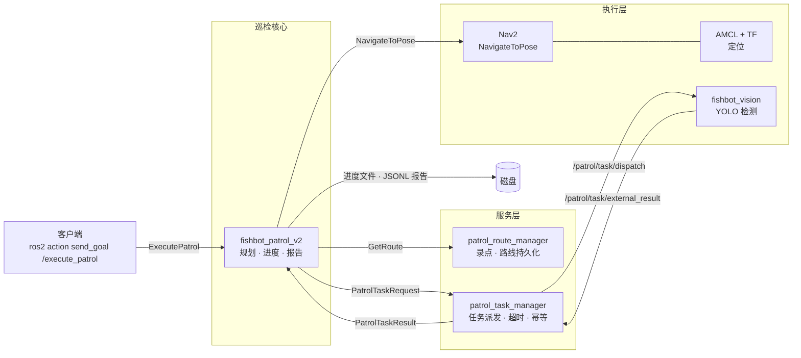

# Fishbot 自主巡检系统

> 基于 ROS 2 + Nav2 的差速小车自主巡检方案：录一次路线，之后自动跑、断点续跑、发现异常、输出报告。

<!-- 徽章：发布前把 <owner>/<repo> 换成实际地址 -->
[](https://github.com/<owner>/<repo>/actions)
[](LICENSE)
[](https://docs.ros.org/en/humble/)

<!-- 放 60 秒演示 GIF，第一屏决定别人看不看下去 -->


## 功能

- **路线录制与持久化**：遥控走一圈录点，路线存成 JSON，重启不丢。
- **批量巡检**：一条路线循环跑 N 轮，支持顺序 / 逆序 / 随机三种模式。
- **断点续跑**：进程重启后从上次中断的点继续，不重复跑已完成的点。
- **失败策略**：单点失败可选 `stop` / `skip` / `retry`，连续失败达阈值自动熔断。
- **到点校验**：导航结束后用定位残差复核是否真的到位，避免"导航说到了其实没到"。
- **任务派发**：到点后把检测任务发给视觉节点，带超时与幂等保护。
- **报告输出**：每轮一个 JSONL 记录 + 汇总，便于事后统计。
- **Web 控制台**：浏览器里看地图、点地图发导航、建图、看日志和摄像头、跟 AI 说话。

## 架构



数据流一句话：**动作请求进来 → 取路线 → 逐点导航 → 到点校验 → 派任务 → 记进度 → 出报告**。

## 快速开始

```bash
# 1. 编译
colcon build --symlink-install

# 2. 起底盘 + 定位 + 导航
ros2 launch fishbot_bringup bringup.launch.py
ros2 launch fishbot_navigation navigation.launch.py

# 3. 录一条路线（另开终端，遥控走一圈）
ros2 service call /patrol_route/record_point fishbot_patrol_interfaces/srv/RecordPoint

# 4. 跑巡检
ros2 action send_goal /execute_patrol fishbot_patrol_interfaces/action/ExecutePatrol \
  "{route_name: 'demo', mode: 'forward', repeat_count: 1}" --feedback
```

暂停 / 恢复：

```bash
ros2 service call /patrol/pause  std_srvs/srv/Trigger
ros2 service call /patrol/resume std_srvs/srv/Trigger
```

## 包说明

| 包 | 作用 |
| --- | --- |
| `fishbot_patrol_v2` | 巡检执行器：规划、导航、进度、报告、抢占 |
| `fishbot_patrol_route_manager` | 录点、路线存取、激活路线管理 |
| `fishbot_patrol_task_manager` | 到点任务派发、超时、幂等去重 |
| `fishbot_patrol_interfaces` | action / msg / srv 定义 |
| `fishbot_patrol_executor` | v1 执行器（已被 v2 取代，保留做参考） |
| `fishbot_vision` | 摄像头推流 + YOLO 检测 |
| `fishbot_console` | 整机 Web 控制台：地图点击导航、建图、摄像头、日志、看板、AI 助手 |
| `fishbot_navigation` | Nav2 / AMCL / EKF 参数与 launch |
| `fishbot_bringup` | 底盘、TF、雷达启动 |

## Web 控制台

浏览器里做**业务**：启停、看状态、看报告、看摄像头、下发巡检。地图、导航、建图这些专业操作交给 **RViz**，一键启停里点「导航」会自动把 RViz 一起拉起来（`rviz:=true`）。

```bash
ros2 launch fishbot_console console.launch.py          # 默认 8080
ros2 launch fishbot_console console.launch.py http_port:=9000   # 换端口
```

然后打开 `http://<机器人IP>:8080`。

| 面板 | 能做什么 |
| --- | --- |
| 一键启停 | 导航 / 建图 / 巡检 / 看门狗 四行，每行有状态灯、开始、停止；导航与建图互斥，点第二次会被拒绝并给出原因 |
| 状态徽标 | 连接、电量、位姿、相机、错误数，以及 `map/pose/nav/patrol/camera` 六个子系统 |
| 急停 | 常驻红色按钮，按一下立刻停（服务端拦截，不依赖这个页面）；`Esc` 解除 |
| 摄像头 | 检测标注图 / 原始图切换，一键抓拍存盘 |
| 巡检 | 选路线、模式、轮数，开始 / 停止 |
| 录点 | 用当前位置记一个巡检点（可标 expect 有/无），随后写进路线 |
| 报告 | 按路线、时间筛选历史；单次运行的逐点结果与事件 |
| 日志 | `/rosout` 实时滚动，按 WARN/ERROR 过滤，错误数顶在页头；也能收到浏览器端的异常 |
| AI 助手 | 自然语言发指令，动作要过白名单（见下） |

为什么这么分工：控制台做的是"**点了会发生什么、出了事怎么看出来**"，这些不需要三维场景；而地图上拖目标、设初始位姿、存图这些，RViz 已经做了十年，用 Leaflet 复刻一遍只会做出"能用但手感不对"的版本（0.4.x 就是这么过来的：拖拽橡皮筋回弹、代价地图两层叠在一张图上滑走、mapBounds 被强改导致地图空白）。把专业操作交回去，控制台的每一行代码都能被非专业用户直接用到。

巡检点位**只在 RViz 里显示**（黄色 ★ + 编号），按当前路线名过滤，删单点的操作也留在 RViz 的「Publish Point」里——控制台只负责"记一个点"，不做点编辑。

### HTTP 接口

| 接口 | 方法 | 说明 |
| --- | --- | --- |
| `/api/state` | GET | 连接、电量、位姿、子系统、栈状态、急停态 |
| `/api/stacks` | GET | 四个栈的状态（含每个 probe 的期望/实际） |
| `/api/stacks/start`、`/stop` | POST | `{"name": "nav"}` |
| `/api/estop` | POST | 进入 / 解除急停 |
| `/api/routes`、`/api/route_points` | GET | 路线列表与点位 |
| `/api/record_point` | POST | 记点（`name`、`point_id`、`expect`） |
| `/api/markers`、`/markers/clear` | GET/POST | 点位 Marker 的发布与清除 |
| `/api/frame.jpg` | GET | 最新一帧（`?kind=raw|anno`） |
| `/api/runs`、`/api/events` | GET | 历史运行与逐点事件 |
| `/api/logs`、`/api/client_log` | GET/POST | 服务端与浏览器端日志 |
| `/api/patrol`、`/patrol/cancel`、`/cancel_nav` | POST | 下发与取消 |
| `/api/capture` | POST | 抓拍存盘 |
| `/api/ask` | POST | AI 助手 |

### 实时流（rosbridge）

默认会顺带起 `rosbridge_websocket`：`/tf`、`/tf_static`、`/scan` 变成 WebSocket
推送，车一动箭头和点云就是连续的（20+ Hz），不再是一秒几跳。页头那个
「实时 已连」就是它。

```bash
sudo apt install ros-$ROS_DISTRO-rosbridge-suite     # 只装一次
ros2 launch fishbot_console console.launch.py                       # 默认带实时流
ros2 launch fishbot_console console.launch.py rosbridge:=false      # 不要它
```

它是**可选依赖**，整条链路都做了降级：

| 情况 | 表现 |
| --- | --- |
| 装了 rosbridge | 页头「实时 已连」，点云/位姿走推送 |
| 没装 / 端口不通 | 页头「实时 断开」，自动退回 4 Hz 轮询，功能一个不少 |
| TF 还没到 | 这一帧点云不画（宁可不画，也不画错位置） |

点云不在服务端画：服务端只把 `/scan` 的 TF 投影做在轮询路径上；实时路径是
浏览器自己缓存 `/tf` 链、自己算 `map←laser`，画在一张 canvas 覆盖层上（几百个点
用 `circleMarker` 会卡，画像素最省）。ROS 的 TF 用的是四元数，这里只需要平面位姿，
所以每帧压成 yaw——省掉一整条矩阵链，也不会因为 roll/pitch 抖动把点抖歪。

代价地图是自己编码的 RGBA PNG（同一套 `zlib` 代码，不引入图像库），
服务端按"版本号"缓存：costmap 没更新就不重算，所以 1 Hz 轮询也不会烧 CPU。
激光点云在服务端做 TF 投影，`map` 变换拿不到时**整帧丢弃而不是假装有数据**——
宁可少画一帧，也不能把雷达点画错位置。

**手动控制是"死手"开关**：页面按住方向键时以 10 Hz 发 `/cmd_vel`，松手立刻发
零速；即使浏览器崩了、Wi-Fi 断了，服务端超过 `teleop_timeout_sec`（默认
0.6 s）没收到心跳也会自己补一帧零速。也就是说人不在的时候车不会一直跑。

```yaml
# config/console.yaml
cmd_vel_topic: /cmd_vel        # 底盘订阅的角速度/线速度话题
teleop_timeout_sec: 0.6        # 心跳超时，超了就发零速
```

**AI 助手的安全边界**：模型只允许输出 6 种动作（`nav` / `patrol` / `pause` /
`resume` / `cancel_nav` / `snapshot`），坐标会被夹到当前地图范围内，任何不在
白名单里的动作一律丢弃并回话说明。也就是说模型出错最多是"不动"，不可能让它
发一个不存在的指令。没配 API key 时会退化成规则问答（电量、状态、暂停/恢复、
"去 x=1 y=2"），面板不会因为没网而变成死板子。

```bash
export OPENAI_BASE_URL=https://api.openai.com/v1
export OPENAI_API_KEY=sk-...
ros2 launch fishbot_console console.launch.py
```

### 急停

右上角常驻一个红色按钮，快捷键 `Esc`。按下之后：

1. 立刻连发 3 帧零速（单帧可能被底盘的运动控制插值吃掉）
2. 取消正在跑的导航目标与巡检任务
3. **拦下所有会动的入口**：手动控制、点地图发目标、启动巡检、AI 的移动类动作
   全部返回"急停中"，直到再按一次解除

三件事都由服务端保证，不是靠页面自觉：

- 判断在 `bridge._blocked()`，页面只是发 `POST /api/estop`
- 所以即使页面卡死、rosbridge 掉线，车也不会因为"还有人按着方向键"继续走
- 页面上的红按钮只显示服务端返回的状态；请求失败会把按钮回退，绝不会出现
  "页面显示已停、车还在动"

为什么必须有它：在此之前唯一的安全网是 `teleop_timeout_sec`（0.6 s 心跳超时），
那只在"没人再按方向键"时生效；导航正在跑、巡检正在执行的时候，人其实停不下来。

### 不开车也能验证（mock）

改前端最怕"改完还得推车试"。`mock.launch.py` 会拉起控制台 + rosbridge + 一台
假机器人，地图、位姿、点云全都是算出来的：

```bash
ros2 launch fishbot_console mock.launch.py     # 不需要开小车、不需要 nav2
# 浏览器打开 http://127.0.0.1:8080
```

假机器人做四件事，正好覆盖所有"没硬件就看不见"的面板：

| 它发布/订阅 | 于是你能验证 |
|---|---|
| `/map`（latched）10 m×10 m 房间：外墙 + 带门洞的隔断 + 两个方块 | 地图渲染、比例尺、点击换算 |
| 20 Hz `/tf`（`map→odom→base_link→laser_frame`）+ `/odom` | 位姿箭头、实时流、TF 链 |
| 10 Hz `/scan`，射线**真的从这张图上打** | 点云与地图是否对齐（对不齐一眼就看出穿墙） |
| 订阅 `/cmd_vel`；假装 `NavigateToPose` 服务端 | 手动控制、"地图上点一下发目标"能真的跑过去 |

几何部分在 `mock_world.py`（不 import `rclpy`），21 个用例钉的是具体数字：
从 (2,5) 朝 −x 打必须命中左墙内沿 1.90 m、朝门洞打必须穿过去、边转边走必须
是圆弧而不是折线。物理算错时 UI 上只会表现为"怪"，所以这些数字必须单独测。

## 设计取舍

> 这一节比功能列表更能说明工程质量。

- **纯逻辑与 ROS 分离**：规划、进度、报告、工具函数不依赖 `rclpy`，可以在 PC 上直接跑单测，55+ 用例秒级完成。
- **到点校验用 0.5 秒窗口取最坏值**：单帧比对会被定位抖动骗过，改成窗口内反复采样取最大残差，宁可多等半秒也不误判到位。
- **定位质量门限**：协方差超过阈值时拒绝判定，而不是拿不可信的位姿硬比。
- **进度原子写 + 指纹**：`tempfile + fsync + os.replace`，断电不会写坏文件；路线指纹变化则丢弃旧进度，避免跑错路线时"续跑"到错误位置。
- **暂停不占任务预算**：暂停期间时间从 deadline 里扣除，人手动暂停不会导致任务超时。
- **失败按点隔离**：v1 一个点失败整轮作废，v2 改为按策略跳过，并用连续失败计数熔断，避免"一路失败还硬跑完"。

## 测试

```bash
colcon test --packages-select fishbot_patrol_v2 fishbot_console
colcon test-result --verbose
```

纯逻辑部分不依赖 ROS，也可以直接：

```bash
python -m pytest src/fishbot_patrol_v2/test
python -m pytest src/fishbot_console/test
```

`fishbot_console` 的测试里包含一个**真的起 HTTP 服务再用 urllib 打自己的接口**的
端到端用例（用假 bridge 顶替 ROS），所以"按钮 → 接口 → 调用"这条链路在没有
机器人的电脑上也能验证。

## 指标

<!-- 真机跑完后填真实数字，没有数字的部分先删掉 -->
| 指标 | 数值 |
| --- | --- |
| 单点平均耗时 | TBD |
| 单点到点成功率 | TBD |
| 断点续跑恢复耗时 | TBD |
| 检测误报率 | TBD |

## Roadmap

- [ ] 定时 / 班次巡检（按 cron 或班次表自动触发）
- [ ] 视觉异常触发抢占（`/patrol/preempt` 已预留，尚无发布方）
- [x] 网页控制台：地图点击导航 / 建图 / 日志 / 看板 / AI 助手
- [ ] 多机器人同时在同一个控制台里看
- [ ] 异常工单闭环

## License

Apache-2.0，见 [LICENSE](LICENSE)。
