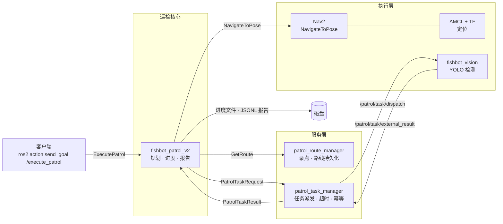

# Fishbot 自主巡检系统

> 基于 ROS 2 + Nav2 的差速小车自主巡检方案：录一次路线，之后自动跑、断点续跑、发现异常、输出报告。

<!-- 徽章：发布前把 <owner>/<repo> 换成实际地址 -->
[](https://github.com/<owner>/<repo>/actions)
[](LICENSE)
[](https://docs.ros.org/en/humble/)

<!-- 放 60 秒演示 GIF，第一屏决定别人看不看下去 -->


## 功能

- **路线录制与持久化**：遥控走一圈录点，路线存成 JSON，重启不丢。
- **批量巡检**：一条路线循环跑 N 轮，支持顺序 / 逆序 / 随机三种模式。
- **断点续跑**：进程重启后从上次中断的点继续，不重复跑已完成的点。
- **失败策略**：单点失败可选 `stop` / `skip` / `retry`，连续失败达阈值自动熔断。
- **到点校验**：导航结束后用定位残差复核是否真的到位，避免"导航说到了其实没到"。
- **任务派发**：到点后把检测任务发给视觉节点，带超时与幂等保护。
- **报告输出**：每轮一个 JSONL 记录 + 汇总，便于事后统计。
- **Web 控制台**：浏览器里看地图、点地图发导航、建图、看日志和摄像头、跟 AI 说话。

## 架构



数据流一句话：**动作请求进来 → 取路线 → 逐点导航 → 到点校验 → 派任务 → 记进度 → 出报告**。

## 快速开始

```bash
# 1. 编译
colcon build --symlink-install

# 2. 起底盘 + 定位 + 导航
ros2 launch fishbot_bringup bringup.launch.py
ros2 launch fishbot_navigation navigation.launch.py

# 3. 录一条路线（另开终端，遥控走一圈）
ros2 service call /patrol_route/record_point fishbot_patrol_interfaces/srv/RecordPoint

# 4. 跑巡检
ros2 action send_goal /execute_patrol fishbot_patrol_interfaces/action/ExecutePatrol \
  "{route_name: 'demo', mode: 'forward', repeat_count: 1}" --feedback
```

暂停 / 恢复：

```bash
ros2 service call /patrol/pause  std_srvs/srv/Trigger
ros2 service call /patrol/resume std_srvs/srv/Trigger
```

## 包说明

| 包 | 作用 |
| --- | --- |
| `fishbot_patrol_v2` | 巡检执行器：规划、导航、进度、报告、抢占 |
| `fishbot_patrol_route_manager` | 录点、路线存取、激活路线管理 |
| `fishbot_patrol_task_manager` | 到点任务派发、超时、幂等去重 |
| `fishbot_patrol_interfaces` | action / msg / srv 定义 |
| `fishbot_patrol_executor` | v1 执行器（已被 v2 取代，保留做参考） |
| `fishbot_vision` | 摄像头推流 + YOLO 检测 |
| `fishbot_console` | 整机 Web 控制台：地图点击导航、建图、摄像头、日志、看板、AI 助手 |
| `fishbot_navigation` | Nav2 / AMCL / EKF 参数与 launch |
| `fishbot_bringup` | 底盘、TF、雷达启动 |

## Web 控制台

浏览器里操作整机，不用记命令。手机连同一个网就能开。

```bash
ros2 launch fishbot_console console.launch.py          # 默认 8080
ros2 launch fishbot_console console.launch.py port:=9000
```

然后打开 `http://<机器人IP>:8080`。

| 面板 | 能做什么 |
| --- | --- |
| 地图 | 显示 `/map`（自己编码 PNG，不依赖 PIL），**拖一下就发导航目标（位置+朝向）**，也能拖出初始位姿 |
| 代价地图 | 全局 + 局部 costmap 叠在底图上（致命红、膨胀橙），可以勾掉 |
| 雷达点云 | `/scan` 投影到 map 坐标系画成点，4 Hz 刷新，可以勾掉 |
| 摄像头 | 检测标注图 / 原始图切换，一键抓拍存盘 |
| 巡检 | 选路线、模式、轮数，开始 / 停止 |
| 建图 | 起停 SLAM、存图 |
| 日志 | `/rosout` 实时滚动，按 WARN/ERROR 过滤，红色计数字段会顶在页头 |
| 历史 | 最近几轮结果（耗时、成功数、召回），以及当前轮的逐点事件 |
| AI 助手 | 自然语言发指令，动作要过白名单（见下） |

地图那一块是照着 RViz 的手感做的：左键拖拽 = 2D Nav Goal（拖多远指多长，
方向就是车头朝向；只点不拖就发一个不带朝向的目标），切到"设定初始位姿"后
同样的手势变成 2D Pose Estimate。已经发出的目标会留一个绿箭头在地图上，
蓝箭头始终是机器人当前位置。

代价地图是自己编码的 RGBA PNG（同一套 `zlib` 代码，不引入图像库），
服务端按"版本号"缓存：costmap 没更新就不重算，所以 1 Hz 轮询也不会烧 CPU。
激光点云在服务端做 TF 投影，`map` 变换拿不到时**整帧丢弃而不是假装有数据**——
宁可少画一帧，也不能把雷达点画错位置。

**AI 助手的安全边界**：模型只允许输出 6 种动作（`nav` / `patrol` / `pause` /
`resume` / `cancel_nav` / `snapshot`），坐标会被夹到当前地图范围内，任何不在
白名单里的动作一律丢弃并回话说明。也就是说模型出错最多是"不动"，不可能让它
发一个不存在的指令。没配 API key 时会退化成规则问答（电量、状态、暂停/恢复、
"去 x=1 y=2"），面板不会因为没网而变成死板子。

```bash
export OPENAI_BASE_URL=https://api.openai.com/v1
export OPENAI_API_KEY=sk-...
ros2 launch fishbot_console console.launch.py
```

## 设计取舍

> 这一节比功能列表更能说明工程质量。

- **纯逻辑与 ROS 分离**：规划、进度、报告、工具函数不依赖 `rclpy`，可以在 PC 上直接跑单测，55+ 用例秒级完成。
- **到点校验用 0.5 秒窗口取最坏值**：单帧比对会被定位抖动骗过，改成窗口内反复采样取最大残差，宁可多等半秒也不误判到位。
- **定位质量门限**：协方差超过阈值时拒绝判定，而不是拿不可信的位姿硬比。
- **进度原子写 + 指纹**：`tempfile + fsync + os.replace`，断电不会写坏文件；路线指纹变化则丢弃旧进度，避免跑错路线时"续跑"到错误位置。
- **暂停不占任务预算**：暂停期间时间从 deadline 里扣除，人手动暂停不会导致任务超时。
- **失败按点隔离**：v1 一个点失败整轮作废，v2 改为按策略跳过，并用连续失败计数熔断，避免"一路失败还硬跑完"。

## 测试

```bash
colcon test --packages-select fishbot_patrol_v2 fishbot_console
colcon test-result --verbose
```

纯逻辑部分不依赖 ROS，也可以直接：

```bash
python -m pytest src/fishbot_patrol_v2/test
python -m pytest src/fishbot_console/test
```

`fishbot_console` 的测试里包含一个**真的起 HTTP 服务再用 urllib 打自己的接口**的
端到端用例（用假 bridge 顶替 ROS），所以"按钮 → 接口 → 调用"这条链路在没有
机器人的电脑上也能验证。

## 指标

<!-- 真机跑完后填真实数字，没有数字的部分先删掉 -->
| 指标 | 数值 |
| --- | --- |
| 单点平均耗时 | TBD |
| 单点到点成功率 | TBD |
| 断点续跑恢复耗时 | TBD |
| 检测误报率 | TBD |

## Roadmap

- [ ] 定时 / 班次巡检（按 cron 或班次表自动触发）
- [ ] 视觉异常触发抢占（`/patrol/preempt` 已预留，尚无发布方）
- [x] 网页控制台：地图点击导航 / 建图 / 日志 / 看板 / AI 助手
- [ ] 多机器人同时在同一个控制台里看
- [ ] 异常工单闭环

## License

Apache-2.0，见 [LICENSE](LICENSE)。
