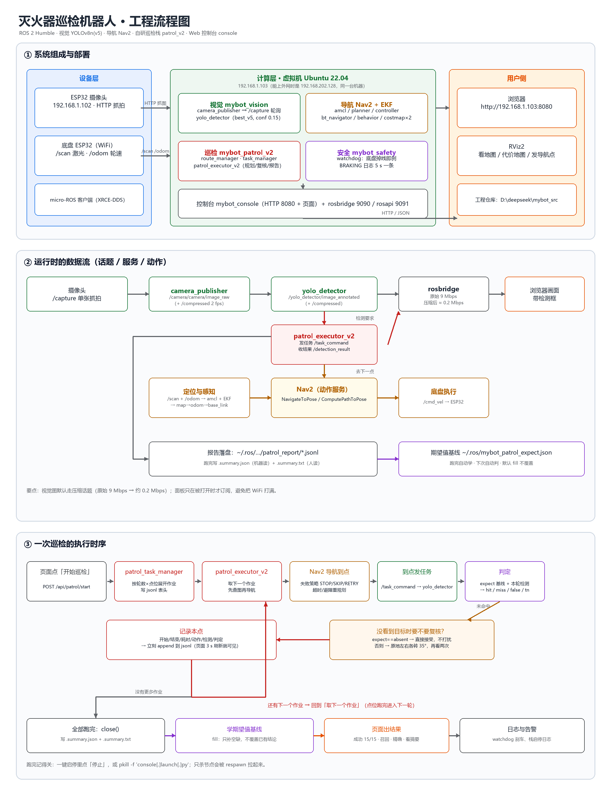
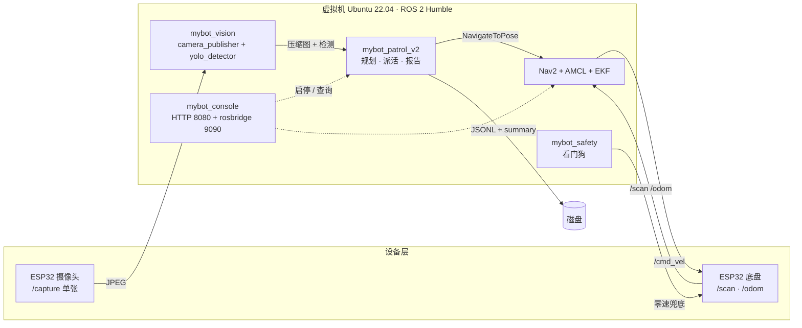

# Mybot 自主巡检平台

> ROS 2 Humble + Nav2 + YOLOv8 的差速小车巡检框架：**录一次路线，之后自己跑、断点续跑、到点识别、跑完出报告**。
> 识别什么由配置决定 —— 默认示例是「灭火器巡检」，换成椅子、消防栓、仪表盘只需要改三个参数，**代码不用动**。

## 换一个巡检目标要改什么

```yaml
# src/mybot_console/config/console.yaml
target_name: '灭火器'              # 页面上怎么称呼它：检测灭火器 / 应该有灭火器
target_class: 'fire_extinguisher'  # 模型输出的类名，跟训练时的 classes 对上
target_states: ''                  # 可选的状态标签，如 '正常,倒地,被遮挡'；留空＝只判有没有
```

改完重启控制台，页面文案、报告措辞、判定逻辑跟着变；再训练一版对应的模型替换权重即可。
**路线、巡检逻辑、报告、基线、控制台全都不用改** —— 这也是为什么它叫"平台"而不是"灭火器机器人"。

**状态：v0.9.0 · 实训交付完成 · 真机已验证，后续以维护为主**
（未做的两件：补同场地新数据把 mAP50 从 0.78 往上推；断网/摄像头掉线预检。见 [路线方案](docs/ROADMAP.md) 的 B1/B4。）

[](https://docs.ros.org/en/humble/)
[](LICENSE)



[](https://www.bilibili.com/video/BV1DJWg6kEAf/)

▶ **[B 站 · 完整版演示 6 分 19 秒](https://www.bilibili.com/video/BV1DJWg6kEAf/)**　真机按路线走到灭火器旁 → 到点识别 → 录点建路线 → 控制台一键启停 / 日志 / AI 助手 → 跑完自动出报告

控制台：`http://<机器人IP>:8080`

> **接手/部署先看 [HANDOVER.md](HANDOVER.md)** —— 机器在哪、怎么起、参数在哪改、故障怎么查，都在那一份里。

## 它解决什么问题

一层楼里有几十具灭火器，靠人定期"走过去看一眼还在不在、有没有被挡住、压力表有没有掉"。
这套东西把这个动作自动化：车沿固定路线走到每个点位，停下来拍一张，用检测模型判断
"这里该有的灭火器还在不在"，跑完输出一份人能直接看的报告。

**设计上只做一件事**：让"跑一趟"变得可重复、可追溯、失败了能接着跑。
不做三维建图、不做机械臂、不做云端调度。

## 功能

- **路线录制与持久化**：遥控走一圈录点（可标"这里应该有/应该没有"），路线存 JSON，重启不丢。
- **批量巡检**：一条路线跑 N 轮，顺序 / 逆序 / 随机三种模式。
- **断点续跑**：进程重启从上次中断的点继续，不重复跑已完成的点；路线变了旧进度自动作废。
- **失败策略**：单点失败可选 `stop` / `skip` / `retry`，连续失败达阈值熔断，不会"一路失败还硬跑完"。
- **到点校验**：导航结束后用 0.5 s 窗口取最坏定位残差复核，避免"导航说到了其实没到"。
- **任务派发**：到点把检测任务发给视觉节点，带超时、幂等去重和"没看到就再看一眼"的复核。
- **期望值基线**：第一次跑完自动记住每个点"应该有/应该没有"，之后每趟自动判定命中 / 误报 / 漏检。
- **报告**：每轮一份 JSONL + `summary.json`（机器读）+ `summary.txt`（人读），页面一键看摘要。
- **Web 控制台**：启停四个业务栈、看状态、下发巡检、录点、看报告与日志、AI 助手。

## 架构



一句话数据流：**点开始巡检 → 取路线 → 逐点导航 → 到点派活 → 判定 → 记一笔 → 跑完判基线、出报告**。

## 快速开始

```bash
# 1. 编译（不要用 --symlink-install：这台机器上它不生效，改了 src 等于没改）
colcon build

# 2. 一条命令起全栈：TF + EKF + AMCL + Nav2 + 巡检 + 控制台
ros2 launch mybot_console robot.launch.py map_yaml_file:=/home/my/maps/map_v2.yaml
```

`robot.launch.py` 的参数：`nav:=true`（导航段，内部已串好 TF→EKF→定位→Nav2→巡检）、
`patrol:=true`、`rviz:=true`（一起拉 RViz）、`http_port:=8080`、`host:=0.0.0.0`。

然后打开 `http://<机器人IP>:8080`，在「一键启停」里点「导航」，等它变成 `运行中 3/3`。

也可以只起某一段：

```bash
ros2 launch mybot_navigation navigation.launch.py rviz:=false   # 导航（不开 RViz）
ros2 launch mybot_console    console.launch.py                  # 只起控制台
ros2 launch mybot_patrol_v2  patrol_v2.launch.py nav:=false console:=false  # 只起巡检
```

用命令行跑一轮（不走页面）：

```bash
ros2 action send_goal /execute_patrol mybot_patrol_interfaces/action/ExecutePatrol \
  "{route_name: 'main2', mode: 'forward', repeat_count: 1}" --feedback
```

## 包说明

| 包 | 作用 |
| --- | --- |
| `mybot_patrol_v2` | 巡检执行器：规划、导航、复核、判定、进度、报告 |
| `mybot_patrol_route_manager` | 录点、路线存取、激活路线管理 |
| `mybot_patrol_task_manager` | 到点任务派发、超时、幂等去重 |
| `mybot_patrol_interfaces` | action / msg / srv 定义 |
| `mybot_console` | Web 控制台 + HTTP 接口 + rosbridge |
| `mybot_vision` | 取流（ESP32 `/capture`）+ YOLO 检测 + 压缩图 |
| `mybot_safety` | 看门狗：`/odom` 断了就持续发零速刹车 |
| `mybot_navigation` | Nav2 / AMCL / EKF 参数与 launch |
| `mybot_bringup` | 底盘、TF、雷达启动 |
| `mybot_patrol_executor` | v1 执行器（已被 v2 取代，仅作参考） |

## Web 控制台

控制台只做**业务**：启停、看状态、下发巡检、看报告。"看地图、拖目标、设初始位姿、存图"
这些交给 RViz ——「一键启停」里点「导航」会自动把 RViz 一起拉起来（`stacks_rviz: true`）。

页面只有四块：

| 面板 | 能做什么 |
| --- | --- |
| **一键启停** | 导航 / 建图 / 巡检 / 看门狗 四行，每行有状态灯、开始、停止；导航与建图互斥；启动失败会摊开「启动日志（最近 N 行）」，状态灯说明 `0/3` 是哪几个节点没起来 |
| **巡检** | 选路线、模式、轮数，开始 / 停止；「看摘要」显示这轮的 `summary.txt`（跑完才有） |
| **录点** | 用当前位置记一个点，选任务类型（`detect` / `inspect` / `photo`）、可选标期望值 |
| **日志 / AI** | `/rosout` 实时滚动可按级别过滤；AI 只能发白名单里的动作，坐标夹在地图范围内 |

页面顶部常驻状态徽标（连接、电量、位姿、相机、错误数）和红色**急停**按钮（`Esc` 解除）。
急停由服务端拦截：进急停后连发 3 帧零速、取消导航与巡检，并且拦下所有会动的入口，
页面卡死也不会出现"显示已停、车还在动"。

### HTTP 接口

| 接口 | 方法 | 说明 |
| --- | --- | --- |
| `/api/state` | GET | 连接、电量、位姿、子系统、栈状态、急停态 |
| `/api/stacks` | GET | 四个栈的状态（含期望/实际节点与 `env`：domain / rmw / 节点数） |
| `/api/stacks/start`、`/stop` | POST | `{"name": "nav"}`；已在跑会拒绝，避免两套 amcl 抢 TF |
| `/api/estop` | POST | 进入 / 解除急停 |
| `/api/routes`、`/api/route_points` | GET | 路线列表与点位 |
| `/api/record_point`、`/api/delete_point` | POST | 记点 / 删点 |
| `/api/runs`、`/api/events`、`/api/report` | GET | 历史运行（含进行中）、逐点事件、人读摘要 |
| `/api/frame.jpg` | GET | 最新一帧（`?kind=raw\|anno`） |
| `/api/logs`、`/api/client_log` | GET/POST | 服务端与浏览器端日志 |
| `/api/patrol`、`/api/patrol/cancel`、`/api/cancel_nav` | POST | 下发与取消 |
| `/api/capture` | POST | 抓拍存盘 |
| `/api/ask` | POST | AI 助手 |

所有 `POST` 都有统一异常兜底（400 参数不合法 / 500 内部错误），不会因为一个坏参数把连接打挂。

### 实时流（rosbridge，可选）

`/tf`、`/scan` 走 WebSocket 推给浏览器；没装 rosbridge 也能用，页面退回轮询，功能一个不少。

```bash
sudo apt install ros-$ROS_DISTRO-rosbridge-suite      # 只装一次
ros2 launch mybot_console console.launch.py rosbridge:=false   # 不要实时流
```

## 视觉

- **取流**：ESP32 的 httpd 只有 4~5 个 socket，长连接必断（实测每个连接 3~4 s 就断），
  所以改成 `/capture` 单张轮询（`capture_mode: true`，5 Hz），断了自动重连、指数退避到 15 s。
- **两种图**：原始 `image_raw`（230 KB/帧）+ 压缩 `image_raw/compressed`（JPEG q60，2 Hz，约 12 KB/帧）。
  浏览器和 rosbridge 只用压缩图：一条 WiFi 上原始图 5 fps 就是 9 Mbps，把入门路由器打满会**全屋断网**。
- **推理**：YOLOv8n，`imgsz 640`、`conf 0.15`、Jetson 上 `device cuda:0`；只对白名单任务
  （`detect/inspect/yolo/vision`）响应，到点后停稳 2 s 再取结果。
- **模型**：自训练 `fire_extinguisher` 单类，test mAP50 **0.78**（正样本 + 负样本各 157/43 张，
  负样本把形似物误报从 23/43 压到 2/43）。

## 巡检与报告

- **复核**：没看到目标时，默认原地左右各转 35° 再看两回（`recheck_strategy: turn`），
  而不是"往前走 0.4 m"——前面往往是墙，一走动 nav2 就得重规划。
- **判定**：`expect`（基线或手填）+ 本轮检测 → 命中 / 误报 / 漏检 / 正确排除。
- **基线**：跑完自动记，下次自动判；默认 `baseline_policy: fill`（只补空缺），
  一次误检不会把整条线上"应该有"改写成"应该没有"。
- **报告**：`~/.ros/mybot_patrol_report/<route>_<时间>_<exec>.jsonl` 逐点追加（跑完立刻能看），
  收尾再写 `.summary.json` 与 `.summary.txt`：

```
巡检报告 · main2
结果    完成     耗时 4 分 44 秒
点位    成功 15 · 跳过 0 · 失败 0（共 15）
期望值  12 个点可判定：命中 0 · 误报 0 · 漏检 0 · 正确排除 12
```

## 部署与运维

```bash
tools/deploy_console.sh          # 杀干净旧进程 → 编译 → 重启 → 自检版本 / 端口 / 元数据
```

几个踩过的坑，脚本里已经写死：

- `--symlink-install` 在这台机器上不生效，必须老老实实 `colcon build`；
- 编译后要刷新 `*.egg-info`（先删再拷），否则 `importlib.metadata` 还报旧版本号；
- 停控制台要杀 `console.launch.py`（launch 有 `respawn_delay=2.0`，只杀节点会自动复活）；
- 强杀会留下 `/dev/shm/fastrtps_*`，脚本启动前会清掉；`ros2 node list` 返回空时先 `ros2 daemon stop`。

## 测试

```bash
python3 -m unittest discover -s src/mybot_console/test       # 246
python3 -m unittest discover -s src/mybot_patrol_v2/test     # 174（7 个需要真机，跳过）
python3 -m unittest discover -s src/mybot_safety/test        # 15
```

纯逻辑（规划、判定、报告、基线）不依赖 `rclpy`，在 PC 上秒级跑完；控制台的测试里还有
「真的起 HTTP 服务再打自己接口」的端到端用例（假 bridge 顶替 ROS）。

## 指标（真机实测）

| 指标 | 数值 |
| --- | --- |
| 一轮巡检（5 轮 × 3 点 = 15 个作业） | 284 s |
| 单点导航耗时 | 9.6 ~ 21.5 s |
| 单点检测耗时 | 2.0 ~ 3.4 s |
| 检测模型 | mAP50 0.78，误报 2/43（负样本集） |
| 电池与阈值 | 3S 锂电，`10.5 / 10.0 V`，2026-11-10 复验：完整跑完未被电量中止 |

## Roadmap

- [x] 断点续跑 / 失败策略 / 到点校验 / 报告
- [x] 网页控制台：启停、巡检、录点、报告、日志、AI 助手
- [x] 期望值基线：跑完自动记，下次自动判
- [x] 压缩图链路：9 Mbps → 约 0.2 Mbps
- [ ] 定时 / 班次巡检（`/patrol/preempt` 已预留，尚无发布方）
- [ ] 多机器人同屏
- [ ] 异常工单闭环

## License

Apache-2.0，见 [LICENSE](LICENSE)。
